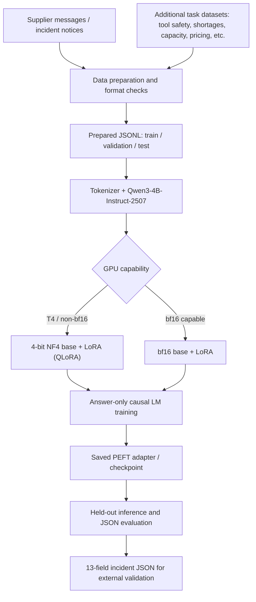

# ASCRA — Autonomous Supply Chain Risk & Logistics Agent

**Qwen3-4B instruction-tuning research | Supply-chain incident extraction | Structured JSON | PEFT (LoRA / QLoRA)**

ASCRA is a notebook-based prototype for turning supplier communications and supply-chain incident notices into structured events that downstream logistics software could validate and review. It is **not** an autonomous logistics platform: there is no verified production deployment, booking workflow, inventory-update tool, or connected enterprise ERP in this repository.

## What is implemented

- A [GPU training, preparation, evaluation and inference notebook](ASCRA.ipynb) targeting `Qwen/Qwen3-4B-Instruct-2507`.
- Incident-notice generation and dataset preparation for a fixed **13-field JSON schema**.
- Multiple task categories including supplier delays, quality defects, shortages, capacity issues, missing or conflicting information and adversarial/tool-safety notices.
- Loss masking for prompt tokens so supervision targets the assistant answer, plus PEFT LoRA adapters.
- GPU-adaptive training schedules, checkpointing, validation-loss logging, post-training generation and JSON comparison on a test subset.
- Example interactive inference via `ascra_infer(notice)` in the notebook.

**Training disclosure:** The author reports using Qwen3-4B with QLoRA. The checked-in notebook implements **different paths depending on hardware**: for a T4/non-bf16 CUDA device it loads 4-bit NF4 weights with bitsandbytes and trains LoRA adapters (**QLoRA**); for bf16-compatible GPUs such as A100, L4 or H100 it loads a bf16 base with LoRA (**not 4-bit QLoRA**). The committed notebook contains **no saved execution outputs**, and no public adapter, run log or evaluation report was located at the repository root. Consequently, no final accuracy, speed, training duration or deployed-model claim is made here.

## Architecture



The notebook produces *proposed structured incident data*. It does **not** execute purchase orders or real inventory changes.

## Incident JSON contract

The schema used by the notebook comprises these fields, with missing data represented as `null` instead of invented values:

```json
{
  "event_type": "supplier_delay",
  "supplier_id": null,
  "shipment_id": null,
  "order_id": null,
  "sku": null,
  "quantity": null,
  "delay_days": null,
  "original_eta": null,
  "revised_eta": null,
  "location": null,
  "reason": null,
  "requires_inventory_check": false,
  "needs_human_review": true
}
```

The JSON above is an **illustrative output shape**, not an excerpt from a completed inference run. The model's generated values must be schema-validated; do not assume it always emits valid JSON.

## Model and training design

| Component | Implementation in notebook |
| --- | --- |
| Base model | `Qwen/Qwen3-4B-Instruct-2507` |
| Fine-tuning method | PEFT LoRA; optional 4-bit QLoRA depending on GPU |
| Quantization on non-bf16 GPU | bitsandbytes 4-bit NF4, double quantization, fp16 compute |
| bf16-capable GPU path | bf16 model weights with LoRA; **no 4-bit base** |
| LoRA rank / alpha / dropout | 16 / 32 / 0.05 |
| Target modules | q/k/v/o projections and gate/up/down MLP projections |
| Maximum sequence length | 1,024 tokens |
| Supervision | Assistant-answer tokens only; prompt masked with `-100` |
| Notebook defaults | 2 epochs; adaptive workload sized against a 20-minute training-loop budget |
| Evaluation subset | Notebook limits held-out generation to 40 rows per source on bf16 path or 16 on non-bf16 path |
| Output | PEFT adapter, checkpoints and generated structured responses when the notebook is executed |

The 20-minute value is a **target budget in the code, not independently verified wall-clock performance**. Loading, preprocessing and evaluation are additional work. Checkpoint content and training metrics have not been committed as evidence.

## Datasets

The repository includes `data/` filenames for domain-specific tasks (supplier notices, inventory shortages, transportation disruption, quality issues, safety, M5 sales, GS1 EPCIS). Several tracked `.jsonl`/`.gz` assets are Git LFS pointer files rather than usable plaintext at their GitHub source location. Download the real LFS objects and check their availability before executing the notebook.

The notebook expects source files in `ROOT/data`, prepares split data under `ROOT/prepared`, and caches generated training artifacts locally. The README does not claim that all source datasets are original, human-labeled, or independently verified. Synthetic incident notices generated using templates can be easier to predict than genuine supplier communication; results on template-derived data should not be marketed as generalization to live logistics operations.

## Run the notebook

1. Clone this repository with Git LFS installed:
   ```bash
   git lfs install
   git clone https://github.com/saivimenthanvl-ai/ASCRA.git
   cd ASCRA
   git lfs pull
   ```
2. Open [ASCRA.ipynb](ASCRA.ipynb) in a CUDA-equipped Colab or similar notebook environment.
3. Set `ROOT` and `DATA_DIR` in **Cell 2** to the actual storage directory containing the source files. In Colab, the current notebook defaults to `/content/drive/MyDrive/ascra`; cloning the repository elsewhere does not automatically change that path.
4. Select a GPU, review the automatically selected quantization mode, and run the notebook cells in sequence. Dependencies are installed by Cell 1. The notebook requires CUDA and is **not** configured for CPU-only full training.
5. Inspect outputs from Cell 7 (training), Cell 8 (loss curves), Cell 9 (per-source held-out generation) and Cell 10 (example inference). Save the adapter and logs separately if you want externally reproducible evidence.

The notebook's training mode and model identifier should be checked before a run. In particular, selecting A100 does not imply QLoRA: it selects bf16 LoRA by default.

## Evaluation design and limitations

Cell 9 computes valid-JSON rate and exact-match rate by source for a **subset** of test records. It also reports field-wise accuracy for synthetic incidents. That is useful prototype instrumentation, but the checked-in notebook has no saved evaluation output.

For a credible benchmark, disclose data provenance, train/test overlap checks, source-wise sample counts, class imbalance, baseline model comparison and error examples. A held-out *synthetic format* is a more demanding check than repeating the same template, but it still does not establish performance on actual supplier messages.

**Security boundary:** Supplier emails and documents are untrusted. The prompt explicitly tells the model not to obey embedded instructions or approve operational changes, but prompt wording is not a security enforcement mechanism. Downstream systems must validate JSON, authenticate actions, enforce permissions and require human approval before inventory, purchasing or shipment actions.

## Repository layout

| Path | Purpose |
| --- | --- |
| `ASCRA.ipynb` | Data preparation, training, evaluation, model loading and inference |
| `data/` | Dataset assets and LFS-tracked source files |
| `test.jsonl` | Root-level LFS-tracked test dataset |
| `.gitattributes` | Git LFS tracking configuration |
| `.gitignore` | Local artifacts and file exclusions |

## Technology

Python, PyTorch, Hugging Face Transformers, Datasets, PEFT, Accelerate, bitsandbytes, safetensors and Matplotlib.

## Project status

**Research/prototype.** The repository demonstrates an implemented Qwen3-4B adapter-training workflow and a structured incident extraction design. It is not evidence of a shipped autonomous agent, production customer impact, completed live API integrations or verified quantitative model performance.

## Attribution

Dataset source licenses and commercial-use rights must be checked for the source files before redistribution or deployment. The underlying pretrained Qwen model has its own licensing and use conditions. No third-party source ownership is claimed here.
