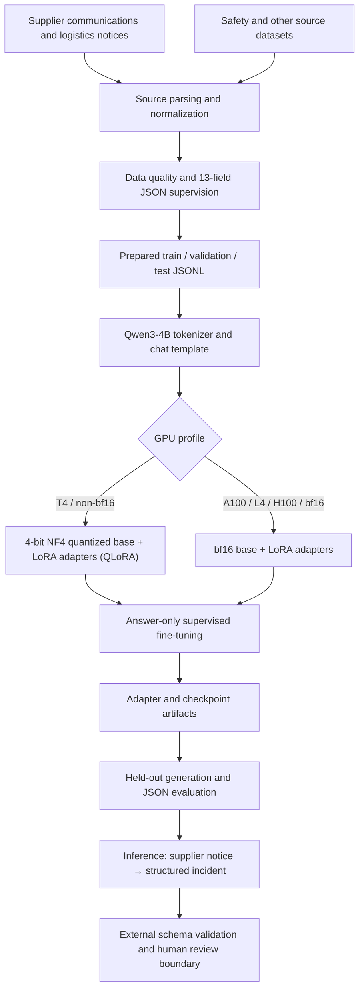
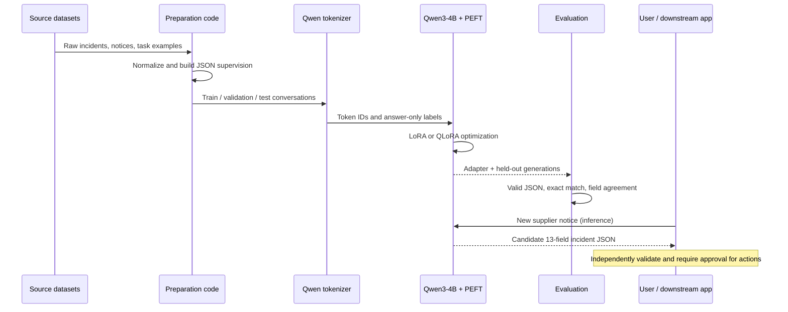
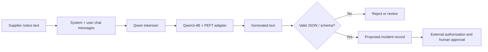

#ASCRA — Autonomous Supply Chain Risk & Logistics Agent
Qwen3-4B · LoRA / QLoRA fine-tuning · Supply-chain incident extraction · Structured JSON

ASCRA is a research prototype for converting supplier communications and logistics notices into machine-readable supply-chain incident records. Its core is a Jupyter notebook, [`ASCRA.ipynb`](ASCRA.ipynb), for preparing data, adapting Qwen/Qwen3-4B-Instruct-2507, evaluating structured responses and running interactive inference.
Project scope: The repository contains a model-training and inference workflow, not a deployed autonomous agent. It does not prove that inventory changes, purchase orders, supplier messages or transport bookings can be executed against live enterprise systems. The notebook has no committed execution outputs or published model benchmark; performance figures must not be inferred from its configuration.

1. End-to-end architecture

The last step is an integration boundary, not an implemented live ERP, dispatch or order-processing service.
2. What each process does
Stage	Input	Operation	Output
Ingestion	Supplier messages, incident notices and domain datasets	Collect task-relevant examples	Source records
Data preparation	Source records	Generate or normalize messages; label known values and missing fields	Chat-style JSONL examples
Split	Prepared examples	Separate training, validation and test material	prepared/train.jsonl, prepared/validation.jsonl, prepared/test.jsonl
Tokenization	System/user/assistant turns	Apply Qwen chat template; tokenize; mask prompt labels with -100	Training tokens and labels
Model adaptation	Qwen3-4B plus tokenized records	Select LoRA or 4-bit QLoRA path according to GPU capability	PEFT adapter/checkpoints
Validation	Validation examples	Track validation loss during training	Loss measurements/logs when run
Held-out evaluation	Test examples	Generate JSON; check parseability and exact-match/field-level agreement	Printed per-source metrics when run
Inference	New supplier notice	Generate a proposed 13-field JSON incident	Machine-readable candidate event
Safe downstream handling	Candidate event	Validate schema, authorization and human approval externally	Only approved downstream actions

2.1 Data preparation
The notebook prepares training data from source files under data/ and synthetic incident notices. Example scenarios cover supplier delays, inventory shortages, component quality problems, supplier capacity, port and transport disruptions, conflicting information, and tool-safety cases. Synthetic notices can be useful for learning the output format but cannot substitute for evaluation on real supplier communications.

A source file can be stored as JSONL or compressed JSONL (.jsonl.gz). This repository uses Git LFS for some large assets: files that appear as short text pointers are not the underlying datasets until LFS objects are downloaded.
2.2 Instruction format and supervised objective
The notebook uses a system instruction, an incoming notice and the expected assistant JSON response. The loss is computed over assistant-answer tokens only; system and user prompt tokens are masked. This teaches a causal language model to produce the target structured response given the notice.
2.3 Model loading: LoRA versus QLoRA
The notebook detects CUDA capability and chooses a memory profile:
Configuration	Model weights	Adaptation	Interpretation
T4 / GPU without bf16 support	4-bit NF4 (double quantization, fp16 compute)	Rank-16 LoRA	QLoRA path
bf16-capable GPU, e.g. A100/L4/H100	bf16 model weights	Rank-16 LoRA	LoRA, not 4-bit QLoRA

Both paths use PEFT adapters on attention and MLP projection modules (q_proj, k_proj, v_proj, o_proj, gate_proj, up_proj, down_proj). Model and adapter weights are different objects: sharing an adapter does not redistribute the full Qwen base model.

Reported training: The project author reports training Qwen3-4B using QLoRA. The repository contains a working design for that procedure, but without saved run logs or adapter artifacts the exact executed training run and its outcome are not independently verifiable from the checked-in notebook.
2.4 Training and checkpointing
The notebook configures the following values, which are settings, not measured results:
Parameter	Notebook configuration
Base model	Qwen/Qwen3-4B-Instruct-2507
LoRA rank / alpha / dropout	16 / 32 / 0.05
Maximum sequence length	1024 tokens
Training epochs	2
Training-loop time target	20 minutes, dynamically calibrated
Seed	42
Learning rate	2e-4 for bf16 path; 1e-4 for non-bf16 path
Batch size	Adaptive to GPU profile
Checkpoints	Saved during training, with adapter output paths configured in the notebook

The 20-minute limit is a scheduling target for the training loop, not a verified end-to-end training duration. Model download, preprocessing, initialization and evaluation add time. The notebook sizes the training run based on a short GPU calibration, so the exact examples trained can vary across hardware.
3. Incident JSON contract
The configured extraction output uses 13 keys. Missing values should be null rather than fabricated. Example illustrative structure:
{
  "event_type": "supplier_delay",
  "supplier_id": null,
  "shipment_id": null,
  "order_id": null,
  "sku": null,
  "quantity": null,
  "delay_days": null,
  "original_eta": null,
  "revised_eta": null,
  "location": null,
  "reason": null,
  "requires_inventory_check": false,
  "needs_human_review": true
}
Important: This illustrates field names, not a recorded model prediction. Generated text can be malformed or factually incorrect. Production consumers must check JSON types, allowed values, provenance, business rules and permissions before doing anything with it.
4. Training-to-inference lifecycle

5. Evaluation: what is and is not demonstrated
Cell 9 of [`ASCRA.ipynb`](ASCRA.ipynb) defines a per-source evaluation that checks:
- Valid JSON rate: fraction of generated outputs that parse as JSON.
- Exact match: fraction whose parsed JSON agrees with the reference object.
- Field-level agreement: matches for fields on synthetic incident extraction examples.
- Per-source breakdown: to avoid disguising weaker tasks under one average.
The evaluation is subsampled: the default notebook uses up to 40 records per source in the bf16 profile and 16 per source otherwise. These are evaluation design choices, not reported scores. The committed notebook has no saved outputs from a completed evaluation, so there is no validated public accuracy, latency or throughput figure.

A strong benchmark would additionally use real, independently labeled supplier notices and test for data leakage, adversarial instructions, schema validity, hallucinated identifiers and generalization to unfamiliar writing styles.
6. How to run
Prerequisites
- Python notebook environment with a supported NVIDIA CUDA GPU and sufficient VRAM.
- Git and Git LFS to obtain large dataset objects.
- Access to the Qwen3-4B model and Hugging Face dependencies.
- Dataset files arranged as the notebook expects.
git lfs install
git clone https://github.com/saivimenthanvl-ai/ASCRA.git
cd ASCRA
git lfs pull
1. Open ASCRA.ipynb in Google Colab or another compatible GPU notebook environment.
2. Cell 1: install transformers, peft, accelerate, bitsandbytes, datasets, safetensors and supporting packages.
3. Cell 2: configure ROOT and DATA_DIR. In Colab the notebook defaults to /content/drive/MyDrive/ascra and mounts Drive; cloning elsewhere does not automatically adjust that path.
4. Cell 3: prepare/cache mixed training and evaluation splits from the configured data.
5. Cells 4–5: tokenize records and load Qwen3-4B with the hardware-appropriate adaptation path.
6. Cells 6–7: construct the Trainer, calibrate GPU work, train and save adapter/checkpoints.
7. Cell 8: plot recorded training/validation loss.
8. Cell 9: generate held-out predictions and inspect JSON evaluation by source.
9. Cell 10: call the interactive inference function ascra_infer(notice).
The notebook requires CUDA for full training; running it in an ordinary CPU-only environment will fail its GPU assertion.
Inference flow

The schema-check and approval nodes describe recommended downstream safeguards; they are not proof of a connected production action system.
7. Repository structure
ASCRA/
├── ASCRA.ipynb          # Dataset preparation, PEFT training, evaluation, inference
├── README.md            # Documentation and architecture
├── data/                # Domain datasets; some files are Git LFS assets
├── test.jsonl           # LFS-tracked dataset at repository root
├── .gitattributes       # Git LFS rules
└── .gitignore           # Local output exclusions
Local outputs such as prepared datasets, training checkpoints, model adapters and evaluation logs are created according to paths configured in the notebook; they are not all included in the public repository.
8. Security and limitations
- Supplier messages may include adversarial text. Instructions embedded in data must never be treated as higher-priority instructions.
- Prompt instructions alone do not create a secure tool-use boundary. Real actions need separate identity checks, permissions, audit logging, validation and human authorization.
- A model that matches synthetic JSON targets has not necessarily learned robust incident detection on real-world language.
- There are no verified production users, logistics integrations, or demonstrated cost savings in the checked-in materials.
- This is a decision-support/research prototype, not an autonomous system authorized to change shipment, procurement or inventory records.
9. Technology stack
Python · PyTorch · Hugging Face Transformers · Qwen3-4B · PEFT · LoRA · QLoRA · bitsandbytes · Accelerate · Datasets · safetensors · Jupyter/Colab
10. Next-step evidence checklist
When publishing real evaluation evidence, include the adapter/checkpoint identifier, exact base-model revision, GPU, seed, datasets and split hashes, trained example count, run logs, valid-JSON/exact-match/field-level scores, and examples of failures. Keep reported outcomes separate from planned features and notebook parameters.
Model and dataset attribution: The Qwen base model and third-party datasets retain their own license and redistribution requirements. Review those terms before commercial use or republishing dataset contents.
